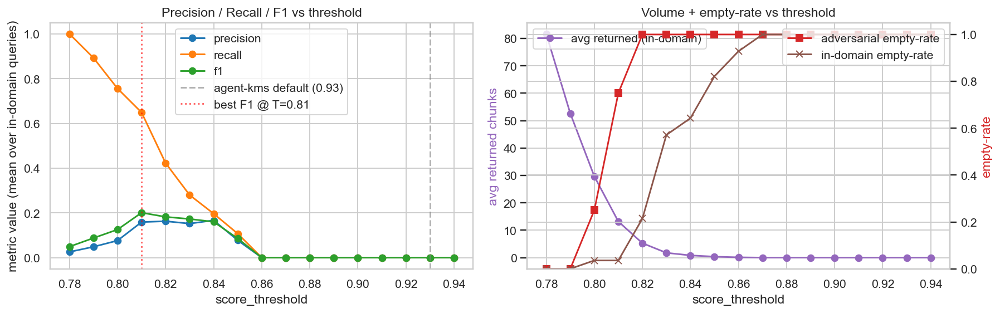
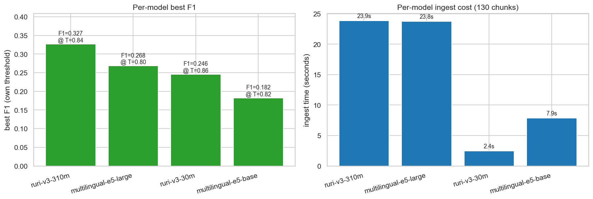
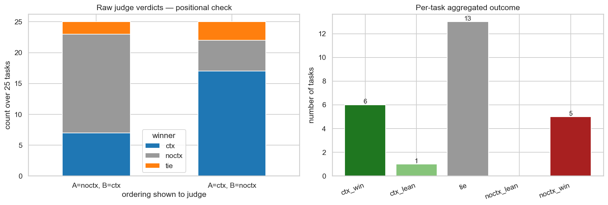

# RAG Retrieval Evaluation on Japanese Technical Documents

> Empirical evaluation of threshold-based vector retrieval for Japanese
> technical documentation, using [agent-kms](https://github.com/spin-glass/agent-kms)
> as the system under test.

## TL;DR

Across **32 hand-authored retrieval queries** and **25 hand-authored
coding tasks** on a **127-chunk corpus** of public React and JavaScript
Primer Japanese documentation, three findings emerged:

1. **agent-kms's documented default of `score_threshold=0.93` does not
   generalize.** On this corpus, every in-domain query returns zero
   chunks at T=0.93 (100% empty-rate). The actual F1-optimal threshold
   for the default model `intfloat/multilingual-e5-base` is **T=0.81,
   F1=0.20** — and the conservative "no out-of-domain false positives"
   boundary is **T=0.82**.

2. **The default embedding model is the weakest of the four tested.**
   Swapping `multilingual-e5-base` (768d) for `cl-nagoya/ruri-v3-310m`
   (768d, Japanese-specialized) raises best F1 from 0.18 to **0.33** —
   a ~80% relative improvement at similar ingest cost and the same
   vector dimensionality.

3. **End-to-end, the retrieved context does NOT measurably improve
   coding quality on this corpus.** A pairwise study of 25 coding
   tasks judged by `qwen2.5:14b` (with order-swap to control positional
   bias) shows ctx wins 6 / noctx wins 5 / ties 13 / McNemar p = 1.0,
   at a ~5× latency cost. Retrieval helps on newer-spec or multi-section
   topics; it actively hurts on trivial one-liner tasks where context
   dilutes the answer.

A user who follows the README defaults on Japanese public documentation
will get 100% empty results until they calibrate the threshold, and
even then will be ~40-80% below the F1 ceiling reachable by switching
the embedding model — but should not assume the better retrieval will
automatically translate to better generated code on a competent LLM
and a corpus the LLM already knows.

## Why this study

agent-kms uses a threshold-based retrieval design (return every chunk
whose `cosine + severity_boost + applicability_penalty >= T`, no
top-k cap). The README's empirically-chosen threshold (0.93) was
derived on one internal corpus; this study quantifies whether that
choice generalizes — and whether the chosen embedding model is the
right default for Japanese-heavy use cases.

## Method

|              |                                                                                                  |
|--------------|--------------------------------------------------------------------------------------------------|
| Corpus       | 15 Japanese tech-doc markdown files → 127 H2 chunks. React JP docs (CC-BY-4.0) + JS Primer JP (CC-BY-4.0). |
| Eval queries | 32 hand-authored. 28 in-domain (with `(filename, H2-heading)` gold), 4 adversarial out-of-domain. |
| Metrics      | Precision@T, Recall@T, F1@T, Avg returned, Empty rate (in-domain + adversarial), MRR, NDCG@10.   |
| Conditions   | Threshold sweep 0.78→0.94 × 4 embedding models × 5 boost ablation configurations.                |

### Embedding models compared
- `intfloat/multilingual-e5-base` (768d) — **agent-kms default**
- `intfloat/multilingual-e5-large` (1024d) — same family, larger
- `cl-nagoya/ruri-v3-310m` (768d) — Japanese-specialized, current generation
- `cl-nagoya/ruri-v3-30m` (256d) — Japanese-specialized, tiny

(Initially planned to test `cl-nagoya/ruri-large` and
`pkshatech/GLuCoSE-base-ja-v2`; both fail to load with current
`transformers` / `sentence-transformers` versions, so we substituted
the `ruri-v3` line — the maintained successor.)

### Isolation
A dedicated Qdrant instance on `localhost:6433` (separate `~/qdrant_eval_data`
volume) is used so the evaluation never touches the user's personal
agent-kms collections on `localhost:6333`. Collection names also use
the `eval_corpus*` prefix as a second layer of isolation.

## Findings

### 1. Threshold sweep (`e5-base`, all retrieve enhancements on)



| threshold | precision | recall | F1    | avg returned | adv empty | in-domain empty |
|-----------|-----------|--------|-------|--------------|-----------|-----------------|
| 0.78      | 0.026     | 1.000  | 0.049 | 81.6         | 0.00      | 0.00            |
| 0.80      | 0.076     | 0.756  | 0.126 | 29.7         | 0.25      | 0.04            |
| **0.81**  | **0.159** | **0.649** | **0.201** | **13.2** | **0.75** | **0.04**     |
| 0.82      | 0.163     | 0.423  | 0.182 | 5.3          | 1.00      | 0.21            |
| 0.83      | 0.152     | 0.280  | 0.173 | 1.8          | 1.00      | 0.57            |
| **0.93**  | **0**     | **0**  | **0** | **0**        | **1.00**  | **1.00**        |

The agent-kms default of 0.93 is structurally unusable on this corpus —
every query returns zero chunks. Best F1 is at T=0.81, and the
adversarial-empty-rate jumps from 0 to 1.0 between T=0.81 and T=0.82,
giving a sharp boundary for the "no false-positive context" regime.

### 2. Embedding model comparison (each model at its own best threshold)



| model                          | best T | P     | R     | F1    | avg ret. | ingest |
|--------------------------------|--------|-------|-------|-------|----------|--------|
| **cl-nagoya/ruri-v3-310m**     | **0.84** | **0.280** | **0.667** | **0.327** | **5.4**  | **23.9s** |
| intfloat/multilingual-e5-large | 0.80   | 0.239 | 0.726 | 0.268 | 14.4     | 23.8s  |
| cl-nagoya/ruri-v3-30m          | 0.86   | 0.226 | 0.518 | 0.246 | 6.2      | 2.4s   |
| intfloat/multilingual-e5-base  | 0.82   | 0.163 | 0.423 | 0.182 | 5.3      | 7.9s   |

- The **agent-kms default model is the weakest** on this corpus.
- `ruri-v3-310m` (768d) is the F1 winner at similar ingest cost to
  `e5-large` (1024d) — a strict storage win for the same quality.
- `ruri-v3-30m` (256d, ~30M params, **2.4s ingest**) is the best
  cost-quality trade-off and still beats `e5-base` by 36% relative F1.
- Per-model best thresholds span **0.80 – 0.86**: a 0.06 range that
  is larger than the F1 differences between models. **Threshold is
  not portable across models.**

### 3. Boost ablation (at T=0.81, the per-corpus best)

| condition                    | P     | R     | F1    | avg ret. | adv empty |
|------------------------------|-------|-------|-------|----------|-----------|
| all on (default)             | 0.159 | 0.649 | 0.201 | 13.2     | 0.75      |
| no severity boost            | 0.159 | 0.649 | 0.201 | 13.2     | 0.75      |
| no applicability penalty     | 0.067 | 0.804 | 0.111 | 40.8     | 0.00      |
| no query expand              | 0.082 | 0.929 | 0.133 | 33.6     | 0.50      |
| vanilla (none of the above)  | 0.030 | 1.000 | 0.058 | 69.0     | 0.00      |

- **Severity boost is a no-op** on an uncurated corpus — every chunk
  has `severity=default`, so the boost dict adds 0 to every score.
- **Applicability penalty (-0.015) is the single most impactful
  filter.** Removing it triples `avg_returned` (13→41) and halves F1.
  Effectively a hidden threshold tightening of 0.015.
- **Query expansion materially helps** on paraphrased queries and on
  adversarial filtering (adv-empty 0.75 → 0.50 when disabled).

### 4. End-to-end pairwise coding evaluation (notebook 07)

Beyond retrieval metrics, **does the retrieved context actually help a
downstream LLM write better code?** We tested this directly: 25 React/JS
coding tasks, run twice through Ollama `qwen3:8b` (with vs. without
agent-kms context), then judged pairwise by `qwen2.5:14b` in **both
orderings** to neutralise positional bias.



| outcome | count | share |
|---|---|---|
| strict ctx wins (won both orderings)     | **6** | 24% |
| strict noctx wins                        | **5** | 20% |
| ties                                     | **13** | 52% |
| McNemar exact p (ctx vs noctx)           | **1.000** | — |
| latency overhead (B_ctx mean / A_noctx mean) | **5.4×** | — |

**On this corpus + qwen3:8b, agent-kms context yields no statistically
significant coding-quality improvement** — and costs ~5× more wall-clock
time per call. Drilling into individual outcomes:

- **Ctx helps** (6 strict wins) on **multi-section / newer-spec topics**:
  Context API, Optional chaining, ES2022 Error Cause, JSON edge cases,
  mutable/immutable array methods.
- **Ctx hurts** (5 strict losses) on **easy one-liner tasks**: trivial
  Greeting component, object destructuring, CSV normalisation. Context
  dilutes a 5-line answer into a verbose 15-line one.

**Methodological note**: the same 50 judge calls without the order-swap
heuristic would have shown noctx winning 16 vs 7 (AB ordering) **or**
ctx winning 17 vs 5 (BA ordering) — *the swap heuristic is doing real
work*. Anyone running similar local LLM-as-judge evals should treat
single-ordering verdicts as untrustworthy.

**Implication for agent-kms / Claude Code workflows**: always-on
retrieval is not free. On generic tech-docs corpora with a competent
LLM, **gated retrieval** (fire only when the corpus actually contains
domain knowledge the LLM lacks) is likely to dominate. The clearest
positive signal in this study lives in topics that are either niche
or post-LLM-training-cutoff — exactly where retrieval should matter
most.

## Recommendations

### For agent-kms upstream

1. **Reconsider the default embedding model.** `multilingual-e5-base`
   was a sensible 2024 choice; the Japanese-specialized landscape has
   moved. `cl-nagoya/ruri-v3-310m` is a strict improvement on
   Japanese-heavy corpora at the same vector dimensionality (768d).
2. **Document the corpus-dependence of `score_threshold=0.93`
   prominently.** The README presents 0.93 as an empirically-chosen
   sweet spot; on at least one realistic corpus it returns zero
   results. A short note ("if `retrieve` returns nothing, try
   T = 0.80 – 0.85 first") would prevent silent failure.
3. **Add a `calibrate-threshold` CLI subcommand.** Given a small
   labelled set (e.g. 20 query → expected-source pairs), it would
   sweep thresholds and propose the F1-optimal one for the user's
   corpus + model.
4. **Make the applicability penalty opt-in for uncurated corpora.**
   The hidden -0.015 shift is the kind of behavior that makes a
   threshold default feel unreliable.

### For agent-kms users

- **Sweep before trusting any default.** The sweep code in
  `src/eval_utils.py` + a YAML query file generalizes to any corpus
  in <100 lines.
- **Calibrate the threshold per (corpus, model) pair.** Per-model best
  thresholds span 0.80 – 0.86 in this study — bigger than the F1
  differences between models.
- **Tag chunks explicitly or disable the boosts.** On a flat corpus,
  severity is a no-op and applicability penalty is a uniform
  -0.015 shift.

## Reproducing

```bash
# 1. Start the evaluation Qdrant (separate from any personal instance)
docker run -d --name rag-eval-qdrant -p 6433:6333 \
  -v ~/qdrant_eval_data:/qdrant/storage qdrant/qdrant:v1.12.0

# 2. Set up this repo
cd rag-evaluation-jp
python3.12 -m venv .venv && source .venv/bin/activate
pip install -e ".[dev]"

# 3. Install agent-kms (editable, so we read the same code we evaluate)
pip install -e <path-to>/agent-kms

# 4. Run notebooks in order
jupyter lab notebooks/
```

Each notebook is end-to-end runnable and writes its own outputs to
`results/`. Notebook 04 spawns one subprocess per embedding model
(via `scripts/run_one_model.py`) to avoid cross-model state spilling
through `sentence-transformers` / `qdrant-client` caches.

## Private evaluation mode

The methodology is most informative when validated on the corpus a tool
will actually be used against. For agent-kms that means real project
documentation — typically proprietary and unpublishable.

Every notebook resolves its paths through `src.eval_utils.resolve_eval_paths()`,
which switches on the `EVAL_MODE` environment variable:

```bash
# Public corpus (default) — React JP + JS Primer JP, committed
jupyter lab notebooks/

# Private corpus — proprietary docs under data/private/, gitignored
EVAL_MODE=private jupyter lab notebooks/
```

Paths resolved per mode:

| | `public`                    | `private`                            |
|---|------------------------------|--------------------------------------|
| corpus dir       | `data/corpus/`              | `data/private/corpus/`              |
| queries file     | `data/eval_queries.yaml`    | `data/private/eval_queries.yaml`    |
| Qdrant collection| `eval_corpus`               | `eval_corpus_private`               |

Setting up the private mode locally (none of these files are tracked):

```bash
mkdir -p data/private/corpus
cp /path/to/your/docs/*.md data/private/corpus/
cp data/eval_queries.example.yaml data/private/eval_queries.yaml
# Hand-author 30-50 (query, gold) pairs in data/private/eval_queries.yaml
EVAL_MODE=private jupyter lab notebooks/
```

### What is publishable from a private run

Aggregate-only metrics are safe to put in this README's "Findings" section
or in a dedicated subsection — for example:

> Validated on a 416-chunk Japanese technical-doc corpus from internal
> projects (not published). The threshold optimum was T=0.85 — close to
> the public corpus's T=0.81 — and the embedding-model ordering was
> reproduced (ruri-v3-310m > e5-large > ruri-v3-30m > e5-base).

Raw chunks, query bodies, retrieved-chunk paths, and per-source-type
breakdowns are kept local. `results-private/` and any file matching
`results/*-private.*` are gitignored alongside `data/private/`.

## Notebook structure

| Notebook | Purpose |
|---|---|
| `01_setup_and_corpus.ipynb` | Verify Qdrant, ingest 127 chunks. |
| `02_baseline_retrieval_qualitative.ipynb` | Eyeball 5 probe queries before quantitative work. |
| `03_threshold_sweep.ipynb` | Sweep T = 0.78 → 0.94; show that the 0.93 default returns zero. |
| `04_embedding_model_comparison.ipynb` | Compare 4 embedding models, each at its own best threshold. |
| `05_boost_ablation.ipynb` | Isolate severity / applicability / query-expand contributions. |
| `06_findings_and_recommendations.ipynb` | Synthesis + recommendations for agent-kms defaults. |
| `07_pairwise_coding_eval.ipynb` | End-to-end pairwise (with-ctx vs no-ctx) eval on 25 coding tasks using Ollama qwen3:8b + qwen2.5:14b judge. |

## Repository layout

```
.
├── README.md                   ← this file
├── pyproject.toml
├── .agent-kms/kms.toml         ← project config for agent-kms ingest
├── notebooks/                  ← Jupyter notebooks (numbered, run in order)
├── src/eval_utils.py           ← Reusable metric implementations
├── scripts/
│   ├── build_notebooks.py      ← Regenerate notebooks from in-source cell definitions
│   ├── run_one_model.py        ← One model → ingest → sweep → CSV (subprocess driver)
│   └── _nbgen.py               ← Notebook-JSON helper
├── data/
│   ├── corpus/                 ← 15 public CC-BY-4.0 markdown files (committed)
│   │   └── LICENSES.md         ← Attribution for every file
│   └── eval_queries.yaml       ← 32 queries with (basename, H2-heading) gold
└── results/                    ← Figures (committed) + CSVs (gitignored)
```

## Limitations

- **N=32 queries is small.** Confidence intervals on F1 are wide;
  consider a single decimal of F1 difference indistinguishable from noise.
- **Single annotator** (myself). Gold relevance judgements reflect one
  person's view of "what should be retrieved for this query."
- **One corpus domain** (React + JS Primer in technical Japanese).
  Conclusions about threshold magnitude may not transfer to enterprise
  wikis, scientific papers, or legal Japanese.
- **No end-to-end LLM evaluation.** We measure retrieval quality, not
  whether the retrieved context lets an LLM produce a correct answer.
- **Snapshot in time.** Embedding models, agent-kms defaults, and corpus
  contents all evolve. Re-run if any of those change materially.

## License

MIT for code in this repository. Corpus files in `data/corpus/` are
CC-BY-4.0 — see `data/corpus/LICENSES.md` for attribution.
